# BÁO CÁO BÀI TẬP THỰC HÀNH LẬP TRÌNH C# WINFORMS

## I. THÔNG TIN SINH VIÊN
* **Họ và tên:** Ngô Gia Thành
* **Mã số sinh viên:** 24810340318
* **Lớp học phần:** Lập trình .NET - Mã Lớp: QTANM1

* **Link Repository:** [https://github.com/ngogiathanh-commits/LTNET-TEST02_24810340318_NgoGiaThanh]

---

## II. DANH SÁCH BÀI TẬP HOÀN THÀNH & TỰ ĐÁNH GIÁ

| Bài tập | Tiêu đề bài tập | Trạng thái | Mức độ hoàn thành (%) |
| :---: | :--- | :---: | :---: |

| **Bài 1** | QUẢN LÝ ĐẶT PHÒNG KHÁCH SẠN (DATA BINDING 2 CHIỀU &
VALIDATION) | Hoàn thành | 100% |
| **Bài 2** | QUẢN LÝ HỒ SƠ NHÂN SỰ & THÔNG TIN LƯƠNG (SYSTEM
DIALOGS & FILE I/O) | Hoàn thành | 100% |
| **Bài 3** | HỆ THỐNG MDI QUẢN LÝ TRƯỜNG HỌC & ĐÀO TẠO (KIẾN
TRÚC MDI) | Hoàn thành | 100% |
| **Bài 4** | BẢNG ĐIỀU KHIỂN TỔNG HỢP BÁO CÁO KHO HÀNG
(ASYNC/AWAIT & KHÔNG KHÓA UI) | Hoàn thành | 100% |
| **Bài 5** | MÔ PHỎNG GIÁM SÁT HỆ THỐNG CẢNH BÁO IOT REAL-TIME
(CROSS-THREAD SAFETY & PROCESSSING) | Hoàn thành | 100% |

---

## III. MINH HỌA GIAO DIỆN & KỸ THUẬT NỔI BẬT

### 1. Bài 1: QUẢN LÝ ĐẶT PHÒNG KHÁCH SẠN (DATA BINDING 2 CHIỀU & VALIDATION)
* **Kỹ thuật áp dụng:** Cấu hình DataGridView bằng code (`AutoGenerateColumns =
false`), Data Binding 2 chiều với `BindingSource`, Validation với `ErrorProvider`.
* **Hình ảnh minh họa Giao diện:**

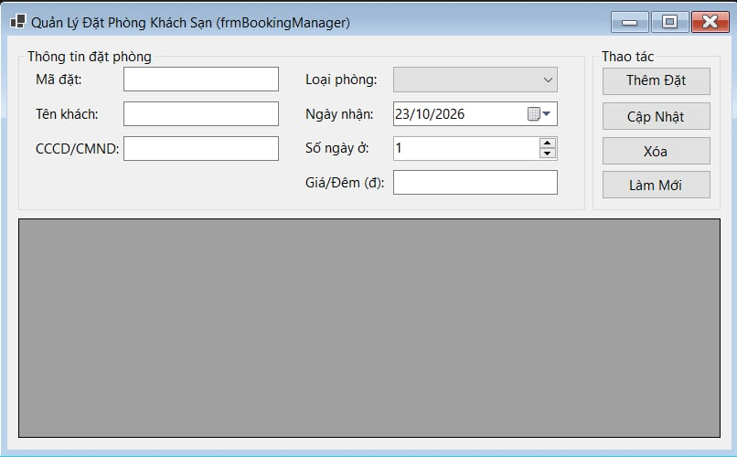


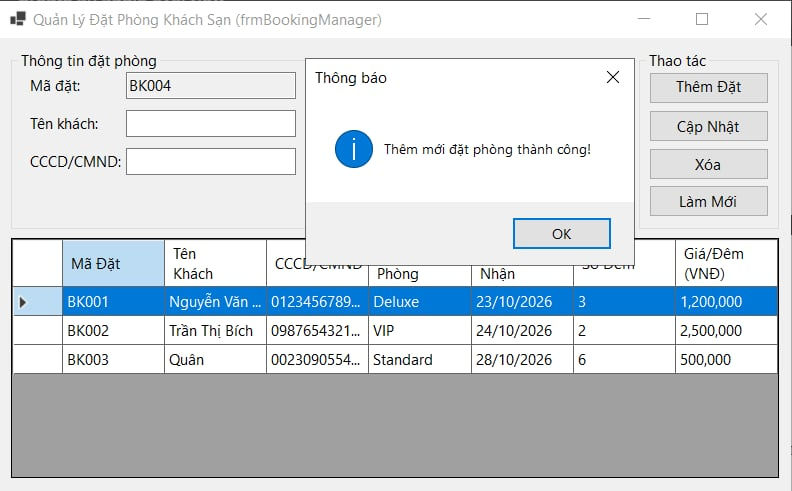

*Mô tả: Giao diện chính hiển thị DataGridView và đồng bộ dữ liệu 2 chiều lên các
TextBox.*

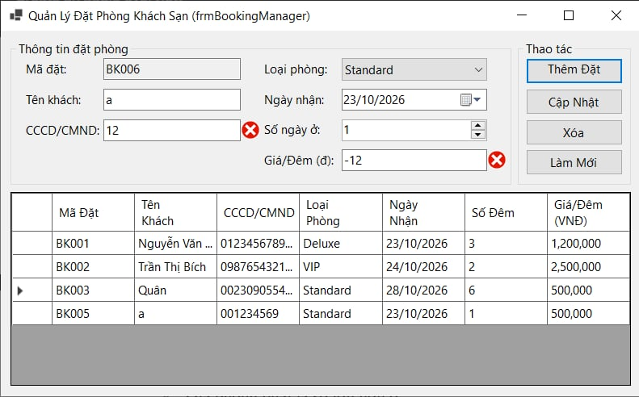

*Mô tả: Kiểm tra hợp lệ dữ liệu nhập vào bằng ErrorProvider khi nhấn Thêm mới.*

---

### 2. Bài 2: QUẢN LÝ HỒ SƠ NHÂN SỰ & THÔNG TIN LƯƠNG
* **Kỹ thuật áp dụng:** `OpenFileDialog` (Tải ảnh bìa), `SaveFileDialog` /
`OpenFileDialog` (Đọc/Ghi file CSV), Cập nhật `StatusStrip` theo thời gian thực.
* **Hình ảnh minh họa Giao diện:**

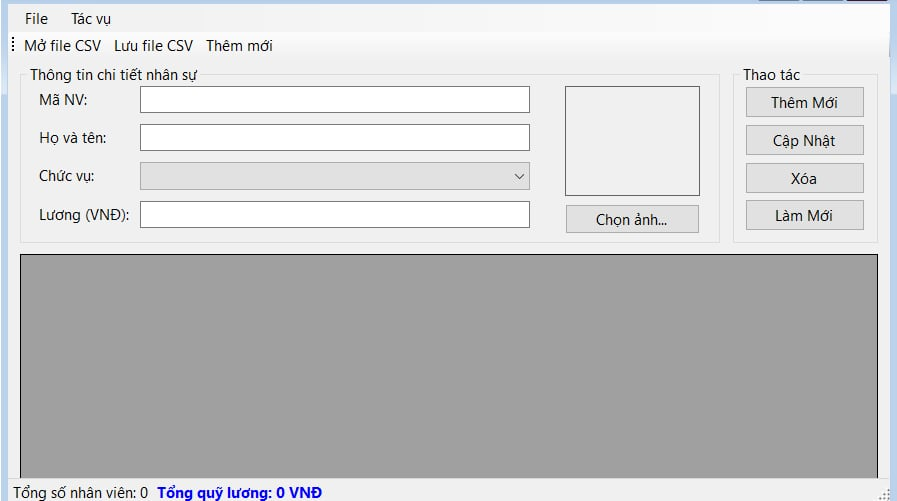


*Mô tả: Chọn ảnh bìa sách từ đĩa cứng hiển thị lên PictureBox và nạp dữ liệu từ file
CSV.*

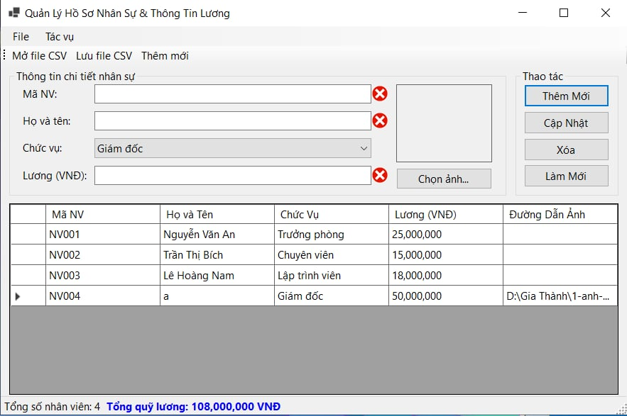

*Mô tả: Kiểm tra lỗi khi không điền thông tin.*

---

### 3. Bài 3: HỆ THỐNG MDI QUẢN LÝ TRƯỜNG HỌC & ĐÀO TẠO
* **Kỹ thuật áp dụng:** MDI Container, Quản lý chống mở trùng Form con,
`async/await` chống treo UI, Safe Cross-Thread bằng `this.Invoke()`.
* **Hình ảnh minh họa Giao diện:**
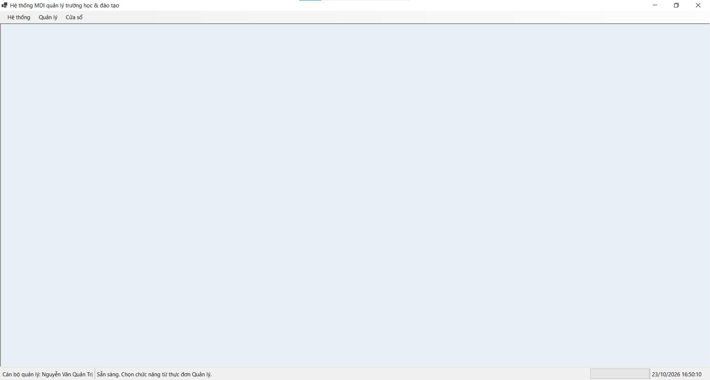

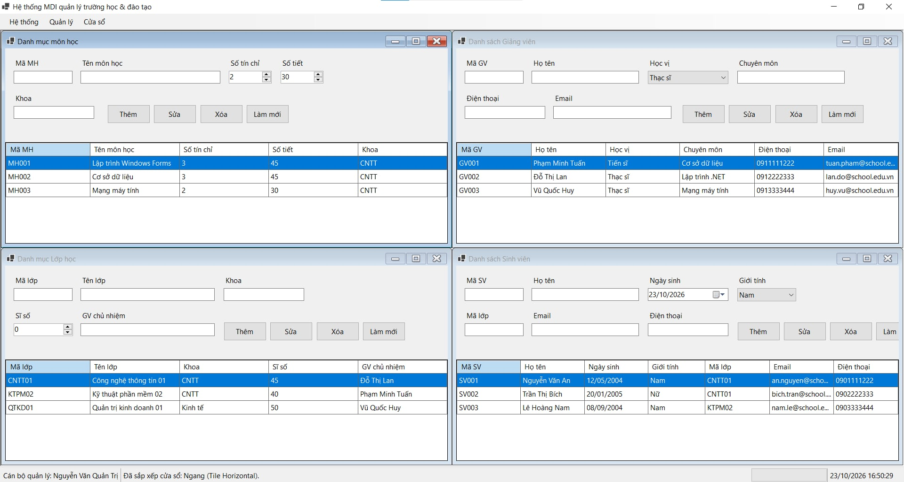

*Mô tả: Khung Form cha MDI điều khiển mở các Form con xếp tầng.*

---

### 4. Bài 4: BẢNG ĐIỀU KHIỂN TỔNG HỢP BÁO CÁO KHO HÀNG
* **Kỹ thuật áp dụng:** async và await để xử lý các tác vụ truy xuất/tính toán,UI Thread luôn mượt mà,CancellationTokenSource.
* **Hình ảnh minh họa Giao diện:**

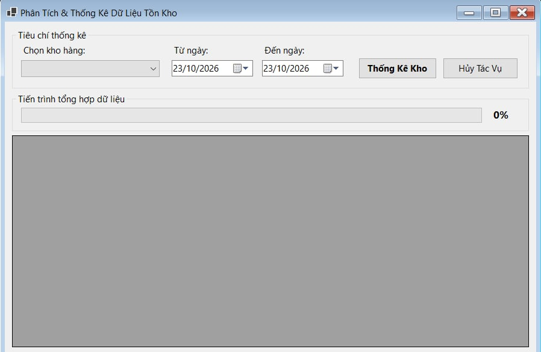


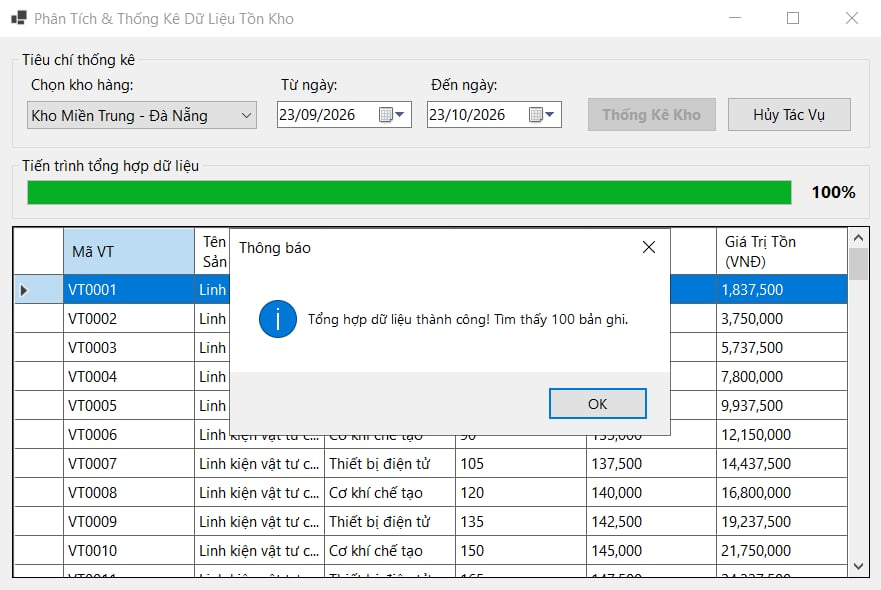

*Mô tả: Tổng hợp dữ liệu kho lớn từ 4-5 giây, người dùng vẫn có thể di chuyển
Form, phóng to/thu nhỏ, chọn các Tab khác mà Form không bị đơ giật.*

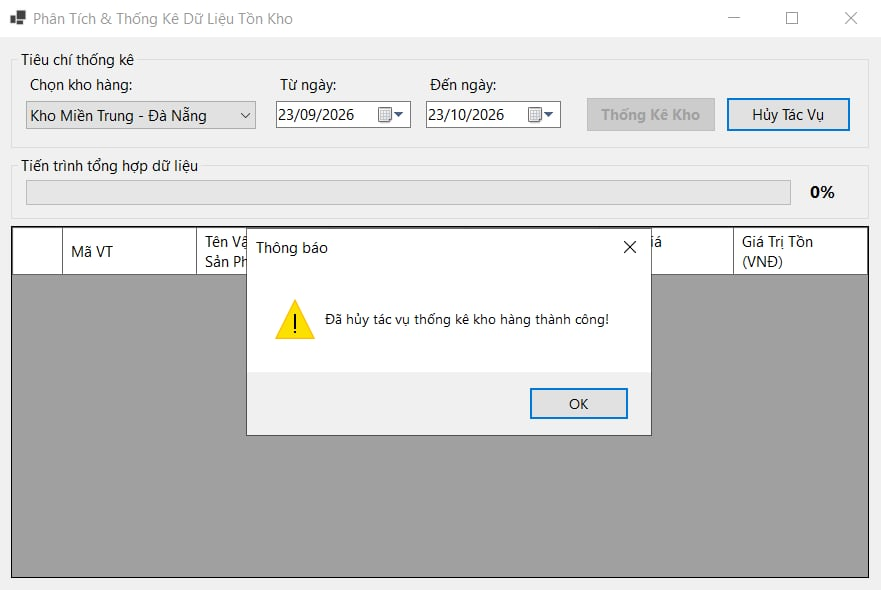

*Mô tả: Hủy tác vụ đưa ra thông báo và xóa tiến trình.*

---

### 5. Bài 5: MÔ PHỎNG GIÁM SÁT HỆ THỐNG CẢNH BÁO IOT REAL-TIME
* **Kỹ thuật áp dụng:** Background Worker / Task Loop,Thread Safety trong WinForms khi truy cập và cập nhật Control UI từ Thread phụ,this.Invoke()/Control.InvokeRequired.
* **Hình ảnh minh họa Giao diện:**

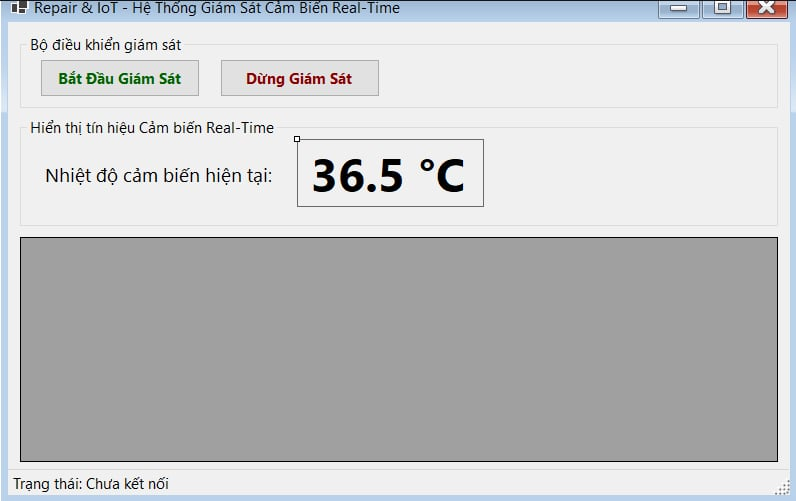

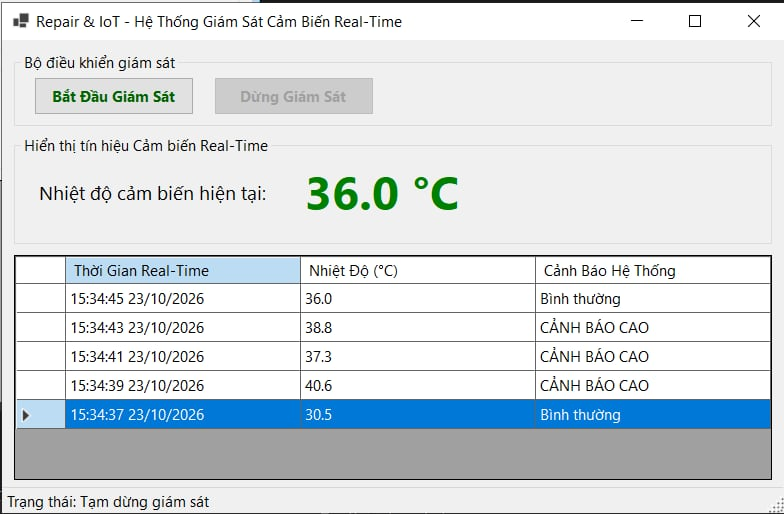

*Mô tả: Giám sát dữ liệu,chạy quá trình và đưa ra khảo sát.*

---
## IV. HƯỚNG DẪN CÀI ĐẶT & CHẠY DỰ ÁN
1. Clone Repository về máy:
```bash

git clone [https://github.com/ngogiathanh-commits/LTNET-TEST02_24810340318_NgoGiaThanh](https://github.com/ngogiathanh-commits/LTNET-TEST02_24810340318_NgoGiaThanh)

2. Mở file solution src/WinFormsAppSolution.sln bằng Visual Studio 2022.
3. Bấm F5 hoặc chọn Start để biên dịch và chạy chương trình.
